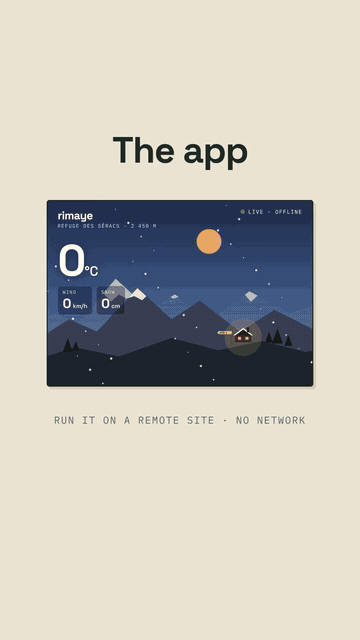
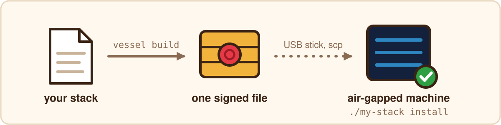

<p align="center">
  
</p>

<h1 align="center">vessel</h1>

<p align="center"><b>Air-gapped delivery for your stack: one signed file, one command.</b></p>

<p align="center">
  <a href="https://github.com/Moq77111113/vessel/actions/workflows/test.yml"></a>
  <a href="go.mod"></a>
  <a href="LICENSE"></a>
</p>

<p align="center">
  
</p>



## With vessel, you

📦 **Ship one file across the air gap.** Images, config and installer travel together. The target never pulls.

🔏 **Sign every release.** The site checks it with `openssl`, no network, no public log.

🔁 **Survive a power cut.** A cut install says where it stopped; `resume` finishes it.

🧹 **Leave nothing behind.** `uninstall` removes exactly what `install` wrote.

## Quick start

```sh
go install github.com/Moq77111113/vessel/cmd/vessel@latest
vessel build ./my-stack --key vessel.key -o my-stack    # where there is network
sudo ./my-stack install                                # on the air-gapped machine
```

`./my-stack` holds your stack and a two-line `vessel.yaml`: `name:` and `version:`.

## Drivers

| driver | reads | target needs |
|---|---|---|
| [compose](docs/drivers/compose.md) | `compose.yaml` | Docker, compose 2.21+ |
| [quadlet](docs/drivers/quadlet.md) | quadlet units | podman 5.0+, systemd |

## Docs

[vessel.yaml](docs/vessel-yaml.md) · [Commands](docs/commands.md) · [Signing](docs/signing.md)

## License

[MIT](LICENSE). v0: the command line may still change.
